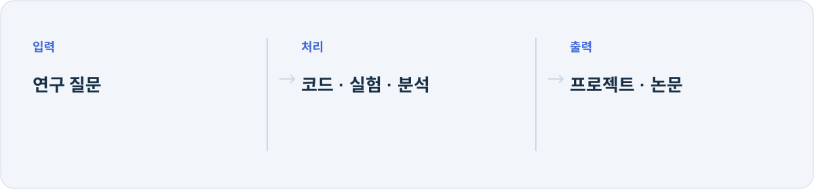

  

<!-- language-choice:start -->
<!-- language-choice:end -->

<!-- readme-header32:start -->

<h1 align="center" id="project-title">Kwak Yunsuk · 곽윤석</h1>

컴퓨터 비전 · 딥러닝 · 소프트웨어

  
  

## 읽기 수준 선택

**편한 출발점을 고르면 프로젝트와 차수별 문서도 같은 레벨로 이어집니다.**

<table align="center">
<thead><tr><th align="left">읽기 수준</th><th align="left">출발점</th></tr></thead>
<tbody>
<tr><td align="left"><a href="docs/%EC%9D%BD%EA%B8%B0%EC%95%88%EB%82%B4/%EB%A0%88%EB%B2%A81.md">LEVEL 1 - Beginner</a></td><td align="left">처음 접하는 분께</td></tr>
<tr><td align="left"><a href="docs/%EC%9D%BD%EA%B8%B0%EC%95%88%EB%82%B4/%EB%A0%88%EB%B2%A82.md">LEVEL 2 - Explorer</a></td><td align="left">원리를 알아보는 분께</td></tr>
<tr><td align="left"><a href="docs/%EC%9D%BD%EA%B8%B0%EC%95%88%EB%82%B4/%EB%A0%88%EB%B2%A83.md">LEVEL 3 - Practitioner</a></td><td align="left">직접 사용하고 실험하는 분께</td></tr>
<tr><td align="left"><a href="docs/%EC%9D%BD%EA%B8%B0%EC%95%88%EB%82%B4/%EB%A0%88%EB%B2%A84.md">LEVEL 4 - Advanced</a></td><td align="left">구현을 이해하고 확장하는 분께</td></tr>
<tr><td align="left"><a href="docs/%EC%9D%BD%EA%B8%B0%EC%95%88%EB%82%B4/%EB%A0%88%EB%B2%A85.md">LEVEL 5 - Expert</a></td><td align="left">전문적으로 검토하는 분께</td></tr>
</tbody>
</table>

<picture>
  <source media="(max-width: 600px) and (prefers-color-scheme: dark)" srcset="assets/readme/flow-ko-dark-mobile.svg" />
  <source media="(max-width: 600px)" srcset="assets/readme/flow-ko-light-mobile.svg" />
  <source media="(prefers-color-scheme: dark)" srcset="assets/readme/flow-ko-dark.svg" />
  <source media="(prefers-color-scheme: light)" srcset="assets/readme/flow-ko-light.svg" />
  
</picture>
<!-- readme-header32:end -->

컴퓨터 비전과 딥러닝을 연구하고, 소프트웨어를 만듭니다.

[ORCID](https://orcid.org/0009-0004-0207-4000) · [논문과 게재 정보](docs/%EB%85%BC%EB%AC%B8%EB%AA%A9%EB%A1%9D.md) · [프로젝트 둘러보기](#projects)

수준별 설명

### LEVEL 1 - Beginner

기술 이름보다 <strong>무엇을 만들었고 어떤 순서로 동작하는지</strong>부터 읽습니다. 
낯선 용어는 생활 속 예와 입력·출력으로 풀어 설명합니다.

### LEVEL 2 - Explorer

각 기능을 연결하는 <strong>개념과 처리 흐름</strong>을 살펴봅니다. 
비슷해 보이는 연구도 입력 변환·특징 변환·분류·검출처럼 역할을 나누어 읽습니다.

### LEVEL 3 - Practitioner

<strong>준비물·실행 순서·설정·결과 확인</strong>을 중심으로 읽습니다. 
코드가 제공된 프로젝트와 논문 중심 연구를 구분하고, 실제로 가능한 범위를 확인합니다.

### LEVEL 4 - Advanced

<strong>모듈 경계·설계 선택·실패 처리·실험 조건</strong>을 살펴봅니다. 
변경하려는 부분이 다른 단계와 결과 해석에 주는 영향을 함께 확인합니다.

### LEVEL 5 - Expert

<strong>평가 프로토콜·측정 근거·재현 조건·한계</strong>를 대조합니다. 
원고의 주장, 공개 코드의 구현, 실제 관측 기록이 같은 범위를 설명하는지 검토합니다.

## 프로젝트

[컴퓨터 비전](#computer-vision) · [비전·언어 연결](#vision-language) · [자연어 처리](#nlp) · [추천 시스템](#recommenders) · [시계열 예측·모의운용](#time-series) · [임베디드·IoT](#embedded) · [데스크톱 소프트웨어](#desktop) · [Android 자동화](#android) · [게임 프로그래밍](#game)

## 컴퓨터 비전

<table align="center">
<thead><tr>
<th align="left">프로젝트</th>
<th align="left">접근 방법·주요 내용</th>
</tr></thead>
<tbody>
<tr>
<td align="left"><a href="https://github.com/PUVKID/Lung-CT-Privacy-Project">Lung CT Privacy Project</a></td>
<td align="left">영상 분류·프라이버시 입력·특징 변환에 따른 폐 CT 분류 성능 비교</td>
</tr>
<tr>
<td align="left"><a href="https://github.com/PUVKID/Camera-Module-Anomaly-Project">Camera Module Anomaly Project</a></td>
<td align="left">영상 분류 YOLO·ViT·CNN으로 카메라 모듈 정상·불량 분류</td>
</tr>
<tr>
<td align="left"><a href="https://github.com/PUVKID/Face-CT-Transfer-Project">Face CT Transfer Project</a></td>
<td align="left">얼굴 평가·전이학습 얼굴 벤치마크 평가와 폐 CT 분류 전이 연구</td>
</tr>
<tr>
<td align="left"><a href="https://github.com/PUVKID/CXR-Privacy-Lab">CXR Privacy Lab</a></td>
<td align="left">환자 재식별 흉부 X선의 블러·모자이크와 재식별 성능 비교</td>
</tr>
<tr>
<td align="left"><a href="https://github.com/PUVKID/Ball-Defect-Detection-Project">Ball Defect Detection Project</a></td>
<td align="left">객체 검출 YOLOv8n과 영상 필터로 작은 볼 결함 검출</td>
</tr>
<tr>
<td align="left"><a href="https://github.com/PUVKID/SafeWalk-Object-Detection-Project">SafeWalk Project</a></td>
<td align="left">객체 검출 보행환경 데이터 통합과 8개 클래스 탐지</td>
</tr>
<tr>
<td align="left"><a href="https://github.com/PUVKID/Illegal-Dumping-Detection-Project">Illegal Dumping Detection Project</a></td>
<td align="left">검출·추적 물체 정지 시간과 사람의 이탈에 따른 이벤트 탐지</td>
</tr>
<tr>
<td align="left"><a href="https://github.com/PUVKID/Camera-Module-Gap-Detection-Project">Camera Module Gap Project</a></td>
<td align="left">기하 정렬·영상 처리 영상 정렬과 영역별 필터로 카메라 모듈 틈 측정</td>
</tr>
</tbody>
</table>

## 비전·언어 연결

<table align="center">
<thead><tr>
<th align="left">프로젝트</th>
<th align="left">접근 방법·주요 내용</th>
</tr></thead>
<tbody>
<tr>
<td align="left"><a href="https://github.com/PUVKID/Drawing-Analysis-Project">Drawing Analysis Project</a></td>
<td align="left">탐지 요약·대화 YOLO 결과를 GPT 대화와 분석 PDF로 연결</td>
</tr>
<tr>
<td align="left"><a href="https://github.com/PUVKID/Art-Therapy-Dialogue-Project">Art Therapy Dialogue Project</a></td>
<td align="left">대화·평가 그림 탐지 요약으로 대화를 구성하고 평가</td>
</tr>
</tbody>
</table>

## 자연어 처리

<table align="center">
<thead><tr>
<th align="left">프로젝트</th>
<th align="left">접근 방법·주요 내용</th>
</tr></thead>
<tbody>
<tr>
<td align="left"><a href="https://github.com/PUVKID/Pokemon-Brand-Analysis-Project">Pokémon Brand Analysis Project</a></td>
<td align="left">감성·콘텐츠 분류 리뷰·콘텐츠의 분류와 감성 분석</td>
</tr>
</tbody>
</table>

## 추천 시스템

<table align="center">
<thead><tr>
<th align="left">프로젝트</th>
<th align="left">접근 방법·주요 내용</th>
</tr></thead>
<tbody>
<tr>
<td align="left"><a href="https://github.com/PUVKID/ADHD-Play-Therapy-Project">ADHD Play Therapy Project</a></td>
<td align="left">사례 기반 추론 유사사례에 따른 놀이치료 콘텐츠 추천 설계</td>
</tr>
<tr>
<td align="left"><a href="https://github.com/PUVKID/Rating-Aware-Recommendation-Project">Rating Aware Recommendation Project</a></td>
<td align="left">그래프 신호 처리 사용자 평점을 반영한 그래프 필터 추천</td>
</tr>
</tbody>
</table>

## 시계열 예측·모의운용

<table align="center">
<thead><tr>
<th align="left">프로젝트</th>
<th align="left">접근 방법·주요 내용</th>
</tr></thead>
<tbody>
<tr>
<td align="left"><a href="https://github.com/PUVKID/Upbit-Paper-Trading-Project">Upbit Paper Trading Project</a></td>
<td align="left">트리 앙상블 XGBoost 예측·모의체결 결과를 보여 주는 대시보드</td>
</tr>
<tr>
<td align="left"><a href="https://github.com/PUVKID/ETF-Project">ETF Project</a></td>
<td align="left">사전학습 시계열 모델 Chronos-2 추가 학습과 원화 기준 ETF 모의운용</td>
</tr>
</tbody>
</table>

## 임베디드·IoT

<table align="center">
<thead><tr>
<th align="left">프로젝트</th>
<th align="left">접근 방법·주요 내용</th>
</tr></thead>
<tbody>
<tr>
<td align="left"><a href="https://github.com/PUVKID/Indoor-Air-Monitor-Project">Indoor Air Monitor Project</a></td>
<td align="left">센서 통신 Arduino 공기질 측정과 Python CSV 기록</td>
</tr>
</tbody>
</table>

[ICT-IndoorAD](https://github.com/ICT-IndoorAD)의 공동 프로젝트에서 Arduino 센서 측정·LCD/LED 표시와 Python CSV 기록을 맡았습니다. 코드는 [개인 담당 저장소](https://github.com/ICT-IndoorAD/Yunsuk-Kwak)에도 있습니다.

## 데스크톱 소프트웨어

<table align="center">
<thead><tr>
<th align="left">프로젝트</th>
<th align="left">접근 방법·주요 내용</th>
</tr></thead>
<tbody>
<tr>
<td align="left"><a href="https://github.com/PUVKID/FlipRing-File-Converter-Project">FlipRing Project</a></td>
<td align="left">문서 처리 파일 변환·PDF 편집·OCR을 제공하는 Windows 앱</td>
</tr>
<tr>
<td align="left"><a href="https://github.com/PUVKID/Codex-Orbit">Codex Orbit</a></td>
<td align="left">바탕화면 위젯·알림 로컬 Codex 작업 상태·모델 변경을 보여 주는 Windows 위젯</td>
</tr>
</tbody>
</table>

## Android 자동화

<table align="center">
<thead><tr>
<th align="left">프로젝트</th>
<th align="left">접근 방법·주요 내용</th>
</tr></thead>
<tbody>
<tr>
<td align="left"><a href="https://github.com/PUVKID/PXE-Touch-Macro-Project">PXE Project</a></td>
<td align="left">접근성·화면 인식 화면 글자·접근성 정보에 따른 조건별 터치 자동화</td>
</tr>
</tbody>
</table>

## 게임 프로그래밍

<table align="center">
<thead><tr>
<th align="left">프로젝트</th>
<th align="left">접근 방법·주요 내용</th>
</tr></thead>
<tbody>
<tr>
<td align="left"><a href="https://github.com/PUVKID/Hole-It-Game-Project">Hole It Project</a></td>
<td align="left">Unity 게임플레이 물체를 흡수하며 성장하는 게임</td>
</tr>
</tbody>
</table>

---

## 기술과 도구

**Python · C# · Arduino · Unity**

  
  
  
  

  
  
  
  

  
  

## GitHub 활동

  <a href="https://github.com/PUVKID"><picture>
    <source media="(prefers-color-scheme: dark)" srcset="https://streak-stats.demolab.com?user=PUVKID&amp;hide_longest_streak=true&amp;theme=github-dark-blue" />
    
  </picture></a>
  <a href="https://github.com/PUVKID?tab=repositories"><picture>
    <source media="(prefers-color-scheme: dark)" srcset="https://github-stats-extended.vercel.app/api/top-langs/?username=PUVKID&amp;layout=donut&amp;theme=github_dark" />
    
  </picture></a>

[GitHub 프로필](https://github.com/PUVKID) · [전체 저장소](https://github.com/PUVKID?tab=repositories)

---

[프로젝트별 차수와 문서](docs/REVISION_INDEX.md)에서 상세 설명과 변경 내용을 볼 수 있습니다.

<table align="center">
<thead><tr>
<th align="left">둘러보기</th>
<th align="left">내용</th>
</tr></thead>
<tbody>
<tr>
<td align="left">프로필</td>
<td align="left">이미지 <a href="assets">단단지 배너</a> 소개 <a href="README.md">소개</a> 프로젝트 <a href="docs/REVISION_INDEX.md">프로젝트 탐색</a></td>
</tr>
</tbody>
</table>
