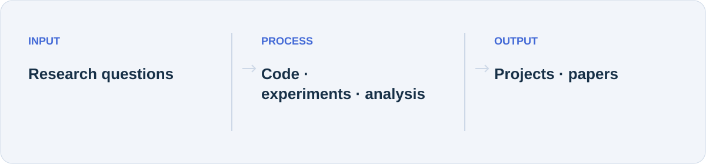

  

<!-- language-choice:start -->
<!-- language-choice:end -->

<!-- readme-header32:start -->

<h1 align="center" id="project-title">Kwak Yunsuk · 곽윤석</h1>

Computer vision · deep learning · software

  
  

  
  
  
  
  

<picture>
  <source media="(max-width: 600px) and (prefers-color-scheme: dark)" srcset="../assets/readme/flow-en-dark-mobile.svg" />
  <source media="(max-width: 600px)" srcset="../assets/readme/flow-en-light-mobile.svg" />
  <source media="(prefers-color-scheme: dark)" srcset="../assets/readme/flow-en-dark.svg" />
  <source media="(prefers-color-scheme: light)" srcset="../assets/readme/flow-en-light.svg" />
  
</picture>
<!-- readme-header32:end -->

I research computer vision and deep learning and build software.

[ORCID](https://orcid.org/0009-0004-0207-4000) · [Papers and publication information](docs/%EB%85%BC%EB%AC%B8%EB%AA%A9%EB%A1%9D.md) · [Explore projects](#projects)

## Choose a reading level

**Choose a starting point and follow the same level through the project and revision documents.**

<table align="center">
<thead><tr><th align="left">Reading level</th><th align="left">Starting point</th></tr></thead>
<tbody>
<tr><td align="left"><a href="docs/%EC%9D%BD%EA%B8%B0%EC%95%88%EB%82%B4/%EB%A0%88%EB%B2%A81.md">LEVEL 1 - Beginner</a></td><td align="left">For newcomers</td></tr>
<tr><td align="left"><a href="docs/%EC%9D%BD%EA%B8%B0%EC%95%88%EB%82%B4/%EB%A0%88%EB%B2%A82.md">LEVEL 2 - Explorer</a></td><td align="left">For readers exploring principles</td></tr>
<tr><td align="left"><a href="docs/%EC%9D%BD%EA%B8%B0%EC%95%88%EB%82%B4/%EB%A0%88%EB%B2%A83.md">LEVEL 3 - Practitioner</a></td><td align="left">For those using and experimenting</td></tr>
<tr><td align="left"><a href="docs/%EC%9D%BD%EA%B8%B0%EC%95%88%EB%82%B4/%EB%A0%88%EB%B2%A84.md">LEVEL 4 - Advanced</a></td><td align="left">For those studying and extending implementations</td></tr>
<tr><td align="left"><a href="docs/%EC%9D%BD%EA%B8%B0%EC%95%88%EB%82%B4/%EB%A0%88%EB%B2%A85.md">LEVEL 5 - Expert</a></td><td align="left">For expert reviewers</td></tr>
</tbody>
</table>

About the levels

### LEVEL 1 - Beginner

Start with <strong>what was built and how it works step by step</strong>, rather than the names of technologies. 
Unfamiliar terms are explained through everyday examples and inputs and outputs.

### LEVEL 2 - Explorer

Explore the <strong>concepts and processing flow</strong> connecting each function. 
Distinguish roles such as input transformation, feature transformation, classification, and detection, even in similar-looking studies.

### LEVEL 3 - Practitioner

Focus on <strong>prerequisites, execution steps, settings, and checking results</strong>. 
Distinguish projects with available code from paper-focused research and check what can actually be done.

### LEVEL 4 - Advanced

Examine <strong>module boundaries, design choices, failure handling, and experimental conditions</strong>. 
Consider how a proposed change affects other stages and interpretation of results.

### LEVEL 5 - Expert

Compare <strong>evaluation protocols, measurement evidence, reproducibility conditions, and limitations</strong>. 
Check whether manuscript claims, public code, and actual observations describe the same scope.

## Project

[Computer vision](#computer-vision) · [Vision and language](#vision-language) · [Natural language processing](#nlp) · [Recommender systems](#recommenders) · [Time-series forecasting and simulated trading](#time-series) · [Embedded systems and IoT](#embedded) · [Desktop software](#desktop) · [Android automation](#android) · [Game programming](#game)

## Computer vision

<table align="center">
<thead><tr>
<th align="left">Project</th>
<th align="left">Approach and key work</th>
</tr></thead>
<tbody>
<tr>
<td align="left"><a href="https://github.com/PUVKID/Lung-CT-Privacy-Project/blob/main/en/README.md">Lung CT Privacy Project</a></td>
<td align="left">Image classification and privacy Compare lung CT classification performance under input and feature transformations</td>
</tr>
<tr>
<td align="left"><a href="https://github.com/PUVKID/Camera-Module-Anomaly-Project/blob/main/en/README.md">Camera Module Anomaly Project</a></td>
<td align="left">Image classification Classify camera modules as normal or defective using YOLO, ViT, and CNN</td>
</tr>
<tr>
<td align="left"><a href="https://github.com/PUVKID/Face-CT-Transfer-Project/blob/main/en/README.md">Face CT Transfer Project</a></td>
<td align="left">Face evaluation and transfer learning Face benchmark evaluation and transfer research for lung CT classification</td>
</tr>
<tr>
<td align="left"><a href="https://github.com/PUVKID/CXR-Privacy-Lab/blob/main/en/README.md">CXR Privacy Lab</a></td>
<td align="left">Patient re-identification Compare patient re-identification under blur and mosaic transformations of chest X-rays</td>
</tr>
<tr>
<td align="left"><a href="https://github.com/PUVKID/Ball-Defect-Detection-Project/blob/main/en/README.md">Ball Defect Detection Project</a></td>
<td align="left">Object detection Detect small ball defects with YOLOv8n and image filters</td>
</tr>
<tr>
<td align="left"><a href="https://github.com/PUVKID/SafeWalk-Object-Detection-Project/blob/main/en/README.md">SafeWalk Project</a></td>
<td align="left">Object detection Integrate pedestrian environment data and detect eight classes</td>
</tr>
<tr>
<td align="left"><a href="https://github.com/PUVKID/Illegal-Dumping-Detection-Project/blob/main/en/README.md">Illegal Dumping Detection Project</a></td>
<td align="left">Detection and tracking Detect events using how long an object remains stationary and whether a person leaves</td>
</tr>
<tr>
<td align="left"><a href="https://github.com/PUVKID/Camera-Module-Gap-Detection-Project/blob/main/en/README.md">Camera Module Gap Project</a></td>
<td align="left">Geometric alignment and image processing Measure camera module gaps using image alignment and region-specific filters</td>
</tr>
</tbody>
</table>

## Vision and language

<table align="center">
<thead><tr>
<th align="left">Project</th>
<th align="left">Approach and key work</th>
</tr></thead>
<tbody>
<tr>
<td align="left"><a href="https://github.com/PUVKID/Drawing-Analysis-Project/blob/main/en/README.md">Drawing Analysis Project</a></td>
<td align="left">Detection summaries and dialogue Connect YOLO results to GPT dialogue and an analysis PDF</td>
</tr>
<tr>
<td align="left"><a href="https://github.com/PUVKID/Art-Therapy-Dialogue-Project/blob/main/en/README.md">Art Therapy Dialogue Project</a></td>
<td align="left">Dialogue and evaluation Build and evaluate dialogue using drawing detection summaries</td>
</tr>
</tbody>
</table>

## Natural language processing

<table align="center">
<thead><tr>
<th align="left">Project</th>
<th align="left">Approach and key work</th>
</tr></thead>
<tbody>
<tr>
<td align="left"><a href="https://github.com/PUVKID/Pokemon-Brand-Analysis-Project/blob/main/en/README.md">Pokémon Brand Analysis Project</a></td>
<td align="left">Sentiment and content classification Classify reviews and content and analyze sentiment</td>
</tr>
</tbody>
</table>

## Recommender systems

<table align="center">
<thead><tr>
<th align="left">Project</th>
<th align="left">Approach and key work</th>
</tr></thead>
<tbody>
<tr>
<td align="left"><a href="https://github.com/PUVKID/ADHD-Play-Therapy-Project/blob/main/en/README.md">ADHD Play Therapy Project</a></td>
<td align="left">Case-based reasoning Design play therapy content recommendations based on similar cases</td>
</tr>
<tr>
<td align="left"><a href="https://github.com/PUVKID/Rating-Aware-Recommendation-Project/blob/main/en/README.md">Rating Aware Recommendation Project</a></td>
<td align="left">Graph signal processing Graph-filter recommendations incorporating user ratings</td>
</tr>
</tbody>
</table>

## Time-series forecasting and simulated trading

<table align="center">
<thead><tr>
<th align="left">Project</th>
<th align="left">Approach and key work</th>
</tr></thead>
<tbody>
<tr>
<td align="left"><a href="https://github.com/PUVKID/Upbit-Paper-Trading-Project/blob/main/en/README.md">Upbit Paper Trading Project</a></td>
<td align="left">Tree ensembles Dashboard displaying XGBoost predictions and simulated executions</td>
</tr>
<tr>
<td align="left"><a href="https://github.com/PUVKID/ETF-Project/blob/main/en/README.md">ETF Project</a></td>
<td align="left">Pretrained time-series model Further training of Chronos-2 and simulated ETF trading in Korean won</td>
</tr>
</tbody>
</table>

## Embedded systems and IoT

<table align="center">
<thead><tr>
<th align="left">Project</th>
<th align="left">Approach and key work</th>
</tr></thead>
<tbody>
<tr>
<td align="left"><a href="https://github.com/PUVKID/Indoor-Air-Monitor-Project/blob/main/en/README.md">Indoor Air Monitor Project</a></td>
<td align="left">Sensor communication Arduino air-quality measurements and Python CSV logging</td>
</tr>
</tbody>
</table>

In the [ICT-IndoorAD](https://github.com/ICT-IndoorAD) collaborative project, I handled Arduino sensor measurements, LCD/LED display, and Python CSV logging. The code is also in the [repository for my contribution](https://github.com/ICT-IndoorAD/Yunsuk-Kwak).

## Desktop software

<table align="center">
<thead><tr>
<th align="left">Project</th>
<th align="left">Approach and key work</th>
</tr></thead>
<tbody>
<tr>
<td align="left"><a href="https://github.com/PUVKID/FlipRing-File-Converter-Project/blob/main/en/README.md">FlipRing Project</a></td>
<td align="left">Document processing Windows app offering file conversion, PDF editing, and OCR</td>
</tr>
<tr>
<td align="left"><a href="https://github.com/PUVKID/Codex-Orbit/blob/main/en/README.md">Codex Orbit</a></td>
<td align="left">Desktop widget and notifications Windows widget showing local Codex task status and model changes</td>
</tr>
</tbody>
</table>

## Android automation

<table align="center">
<thead><tr>
<th align="left">Project</th>
<th align="left">Approach and key work</th>
</tr></thead>
<tbody>
<tr>
<td align="left"><a href="https://github.com/PUVKID/PXE-Touch-Macro-Project/blob/main/en/README.md">PXE Project</a></td>
<td align="left">Accessibility and screen recognition Conditional touch automation based on screen text and accessibility information</td>
</tr>
</tbody>
</table>

## Game programming

<table align="center">
<thead><tr>
<th align="left">Project</th>
<th align="left">Approach and key work</th>
</tr></thead>
<tbody>
<tr>
<td align="left"><a href="https://github.com/PUVKID/Hole-It-Game-Project/blob/main/en/README.md">Hole It Project</a></td>
<td align="left">Unity gameplay A game in which the player grows by absorbing objects</td>
</tr>
</tbody>
</table>

---

## Technologies and tools

**Python · C# · Arduino · Unity**

  
  
  
  

  
  
  
  

  
  

## GitHub activity

  <a href="https://github.com/PUVKID"><picture>
    <source media="(prefers-color-scheme: dark)" srcset="https://streak-stats.demolab.com?user=PUVKID&amp;hide_longest_streak=true&amp;theme=github-dark-blue" />
    
  </picture></a>
  <a href="https://github.com/PUVKID?tab=repositories"><picture>
    <source media="(prefers-color-scheme: dark)" srcset="https://github-stats-extended.vercel.app/api/top-langs/?username=PUVKID&amp;layout=donut&amp;theme=github_dark" />
    
  </picture></a>

[GitHub profile](https://github.com/PUVKID) · [All repositories](https://github.com/PUVKID?tab=repositories)

---

[Project revisions and documentation (Korean source)](../docs/REVISION_INDEX.md) contain detailed descriptions and changes.

<table align="center">
<thead><tr>
<th align="left">Navigation</th>
<th align="left">Contents</th>
</tr></thead>
<tbody>
<tr>
<td align="left">Profile</td>
<td align="left">Image <a href="../assets">Shuckle banner</a> Introduction <a href="README.md">Introduction</a> Project <a href="../docs/REVISION_INDEX.md">Project index (Korean source)</a></td>
</tr>
</tbody>
</table>
